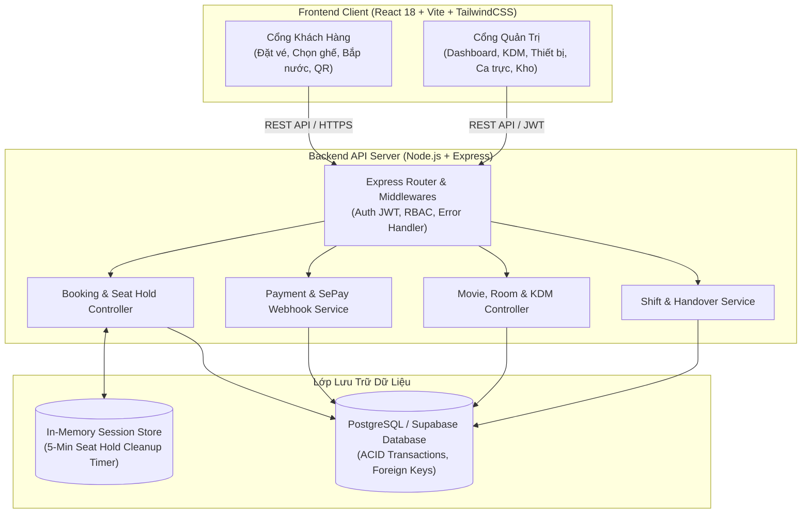

# 🎬 NIGHT MOVIE - HỆ THỐNG QUẢN LÝ VÀ ĐẶT VÉ RẠP CHIẾU PHIM

---

## 📌 Giới Thiệu Dự Án

**Night Movie Cinema Management System** là giải pháp phần mềm toàn diện phục vụ quản lý vận hành cụm rạp chiếu phim kỹ thuật số và cổng thông tin đặt vé trực tuyến đa kênh dành cho khách hàng.

Hệ thống được thiết kế theo tiêu chuẩn công nghiệp hiện đại, giải quyết trọn vẹn bài toán vận hành rạp phim từ quy trình khách hàng (Customer Journey) đến quản trị nội bộ rạp (Internal Operations & ERP).

---

## 🚀 Tính Năng Chính

### 1. Phân Hệ Khách Hàng (Customer Portal)
* **Tra cứu phim & Trailer**: Xem danh mục phim đang chiếu, sắp chiếu, lọc theo thể loại, độ tuổi, xem trailer trực tiếp.
* **Lịch chiếu thông minh**: Chọn rạp, ngày chiếu, suất chiếu linh hoạt theo định dạng 2D, 3D, IMAX Laser.
* **Sơ đồ chọn ghế thời gian thực (Interactive Seat Map)**: 
  * Mô phỏng chuẩn bố cục rạp CGV/Lotte (Ghế thường, VIP, Ghế đôi Sweetbox).
  * Cơ chế khóa giữ ghế (Seat Locking) 5 phút chống đặt trùng đồng thời (Race Condition).
* **Combo bắp nước & Gọi món tận ghế (In-Seat Delivery)**: Tích hợp chọn bắp nước, bánh tart trứng, bim bim kèm vé.
* **Thanh toán chuyển khoản tự động (SePay)**: Tạo mã QR thanh toán ngân hàng tự động đối soát giao dịch thời gian thực.
* **Vé điện tử & Mã QR**: Tự động phát hành vé điện tử có mã QR bảo mật để check-in tại cửa rạp.

### 2. Phân Hệ Quản Trị & Vận Hành (Cinema Operations & Admin)
* **Dashboard Analytics**: Thống kê doanh thu, tỷ lệ lấp đầy rạp, biểu đồ vé theo ngày/tháng/phòng.
* **Quản lý phòng chiếu & Thiết bị**: Giám sát tình trạng ghế, máy chiếu, âm thanh Dolby Atmos, đèn phòng chiếu.
* **KDM & Bảo mật bản quyền phim**: Quản lý khóa bảo mật KDM (Key Delivery Message) theo tiêu chuẩn DCI.
* **Quản lý kho & Bắp nước (Concessions & Inventory)**: Kiểm soát định mức tồn kho bắp rang, nước ngọt.
* **Bàn giao ca & Quản lý thu ngân (Cash & Shift Handover)**: Đối soát tiền mặt, tiền chuyển khoản cuối mỗi ca trực.
* **Quét vé mã QR (Staff QR Scanner)**: Nhân viên soát vé quét mã QR bằng camera thiết bị để kiểm tra vé hợp lệ.

---

## 🏗️ Kiến Trúc Hệ Thống (System Architecture)

---

## 🛠️ Công Nghệ Sử Dụng (Tech Stack)

| Thành Phần | Công Nghệ | Vai Trò |
| :--- | :--- | :--- |
| **Frontend** | React 18, Vite, Tailwind CSS, Lucide Icons | Xây dựng giao diện Single Page Application (SPA) tốc độ cao |
| **Backend** | Node.js, Express.js | Xây dựng RESTful API, xử lý giao dịch nghiệp vụ rạp phim |
| **Cơ Sở Dữ Liệu** | PostgreSQL 15+, Supabase Adapter | Lưu trữ quan hệ ACID chuẩn hóa, tối ưu truy vấn đặt vé |
| **Thanh Toán** | SePay Gateway, Ngân hàng nội địa VietQR | Tự động xác thực giao dịch chuyển khoản qua Webhook |
| **Bảo Mật** | JWT (JSON Web Token), bcryptjs, Helmet, CORS | Phân quyền vai trò người dùng (Admin, Manager, Staff, Customer) |

---

## 📄 Bản Quyền & Tác Quyền
Dự án được xây dựng phục vụ nghiên cứu và phát triển phần mềm quản lý rạp chiếu phim hiện đại.  
© 2026 Night Movie Cinema Team.
